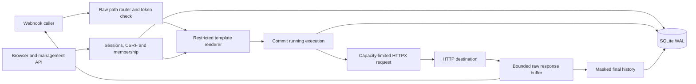

# Architecture and security

Hookrouty is one FastAPI application, rendered with Jinja2 and a small external JavaScript/CSS bundle. Management HTML lives under `/app`, session-authenticated JSON under `/api`, and public token-authenticated hooks under `/hooks`. The browser uses the same API/service authorization paths as API callers.

## Storage

`/data/hookrouty.sqlite3` uses WAL, foreign keys, a busy timeout and versioned SQL migrations. The canonical packaged migration is `src/hookrouty/migrations/0001_initial.sql`; the top-level copy is provided for inspection. Tables are users, sessions, hooks, hook_members, executions, aggregate_counters, app_meta and schema_migrations. IDs are UUID text and timestamps are uniform UTC ISO 8601 strings ending in Z. Queries parameterize values; dynamic SQL uses fixed filter/column clauses.

Management request bodies are limited at the ASGI receive boundary before FastAPI reads or validates models; a fixed deadline also bounds slow management uploads. Anonymous session issuance has an atomic global ceiling of 1000 unexpired rows and reclaims expired rows.

One connection and an asyncio lock serialize local database operations. Explicit transactions use BEGIN IMMEDIATE and roll back on errors/cancellation. The last-admin check and update occur in the same transaction. No transaction spans network I/O. Hook deletion keeps a minimal tombstone and memberships while clearing active config, encrypted fields and token hash. History remains scoped through current memberships and is eventually removed by retention.

## Execution lifecycle

1. Generate a new request ID. Validate raw percent/UTF-8 encoding and select the deterministic route for the incoming method.
2. Check only the selected hook's independent token. Read incoming bytes with a limit; build a restricted template context.
3. Render a fixed-authority destination and validate body/header output. Acquire capacity without waiting and recheck hook existence/enabled state.
4. Commit running history before the HTTP attempt. Failure here returns STORAGE_UNAVAILABLE and sends nothing to the destination.
5. Run one HTTPX call with TLS verification, trust_env=False, no redirect following, no retry, and an asyncio total deadline covering connection plus complete response read.
6. Race destination completion against caller disconnection. Cancel the losing local wait, then finish the execution once. A remote service may already have performed the action.
7. Forward the bounded raw response with filtered end-to-end headers. Recompute Content-Length. Never forward upstream Set-Cookie, hop-by-hop headers or headers named in Connection. HEAD/204/304 have no body.
8. Finish masked history. A final database failure preserves the destination reply and adds a history-unavailable header. Subsequent cleanup marks an orphaned running record interrupted. Restarts do the same without replay.

HTTPX is shared per process for pooling. Cookies received from a destination are not carried into subsequent hook requests. Proxy environment variables cannot redirect traffic. Success/error response bodies are buffered, not streamed. The response limit applies to transferred encoded bytes; gzip remains encoded on the wire. A separate history capture limit applies only after masking.

## Authentication and secrets

Passwords use Argon2id. Webhook tokens use SHA-256 digests; generated tokens and sessions use 32 random bytes. Session digests use HMAC with a session-specific derived key. Authenticated Fernet encryption uses a separately derived key. app_meta stores a one-way key check; it does not store APP_SECRET_KEY. A wrong key refuses startup. Sessions contain an auth version checked against the active account and expire server-side. Login rotates both the session cookie and CSRF token.

Secret field editing identifies rows with stable IDs and explicit keep/replace/remove actions. Secret data is decrypted only inside application services and is never returned by hook reads. Sensitive-value discovery traverses nested arrays conservatively, treating an array containing a sensitive descendant as secret for whole-array substitutions. Known plaintext, JSON-escaped, percent-encoded and form-encoded query representations are removed before capture truncation. Malformed Unicode or excessive JSON nesting is safely omitted from capture. The preview shares the real renderer; references derived from known secret input hide the entire destination field. Body capture parses/redacts a complete JSON value before applying the byte limit. Encoded/binary/secret bodies are omitted. No raw HTTP exception text is inserted into a snapshot or API error.

Jinja autoescaping and DOM textContent keep hook names and destination content inert. A Content Security Policy restricts scripts/styles to same-origin files, denies framing and disallows inline executable code. Session/API pages use no-store, nosniff and no-referrer headers. Public hook responses enforce a separate CSP sandbox with an opaque origin, no scripts, forms or subresource loads. Upstream CSP/reporting headers cannot weaken it. Response bytes remain unchanged; an upstream HTML application requiring JavaScript is intentionally inert when opened through a hook. Dedicated webhook hostnames with management-route isolation are an additional deployment option.

## Trust and operational boundaries

This is a single trusted-team service, not a hardened multitenant outbound fetch platform. Hook editors are authorized to choose internal HTTP(S) destinations; SSRF blocking is intentionally outside this trust model. Network egress rules are an operator decision. A member assignment grants full management of that hook, including its destination and token. Administrators can access all configuration and history. There is no public registration, email recovery, shell execution, distributed queue, scheduling, workflow graph or automatic retry.

Resource capacity and login throttling are process-local; use exactly one worker and one replica. SQLite belongs on local persistent storage. Body capture is deliberately opt-in because application-specific data cannot all be inferred as sensitive. Backups and the secret key must be protected together. A timeout, network failure, shutdown or disconnection is never proof that the remote action did not occur.
